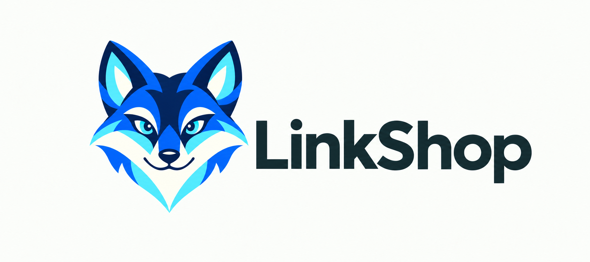

<p align="center">
  
</p>

# LinkShop

## 目录

- [项目简介](#项目简介)
- [主要功能](#主要功能)
- [快速开始](#快速开始)
- [Windows 安装与文件打开](#windows-安装与文件打开)
- [开发与打包](#开发与打包)
- [本地数据与限制](#本地数据与限制)
- [项目结构与文档](#项目结构与文档)
- [许可证](#许可证)

## 项目简介

LinkShop 是使用 Rust 编写的本地 API 调试客户端，提供集合导航、多标签编辑和请求响应查看工作区。打开即可编辑和发送 HTTP 请求，无需账号、登录或云服务，集合、环境、历史和打开的标签保存在本机。

## 主要功能

| 功能 | 说明 |
| --- | --- |
| 请求编辑 | 支持 GET、POST、PUT、PATCH、DELETE、HEAD、OPTIONS 和自定义 HTTP 方法，支持原始文本（raw）、表单编码（URL-encoded）请求体及 JSON 格式化。 |
| 参数与请求头 | 按名称、值、说明编辑，支持调整列宽、启用或停用、复制、删除和批量编辑；查询参数与 URL 同步，保留重复键、百分号编码及停用项。 |
| 集合管理 | 支持嵌套文件夹、搜索、记住展开状态和全部折叠；右键可添加、打开、复制、重命名或删除请求，删除前确认，已打开的编辑内容保留为草稿。 |
| 多标签与草稿保护 | 支持保存、复制以及关闭当前、其他、右侧或全部标签；批量关闭会逐个询问未保存的更改，取消后保留剩余标签，重启可恢复打开的请求。 |
| 身份验证 | 支持 Bearer Token、Basic Auth、API Key（请求头或查询参数）、无身份验证（No Auth），以及继承集合身份验证。 |
| 环境与变量 | 可编辑环境、请求及全局变量，使用 `{{变量名}}` 引用；发送时按“当前环境 > 请求变量（含导入的集合、文件夹变量）> 全局变量”的优先级解析。 |
| 数据导入 | 支持集合（Collection v2/v2.1）、环境及全局变量 JSON，可通过“导入”输入文件或目录路径，也可拖入文件；保留集合层级、停用项、说明、身份验证和原始 JSON，按来源标识跳过重复请求。 |
| 响应与历史 | 查看状态、耗时、大小、JSON 或原始响应体、响应头和响应 Cookie，支持复制响应内容和重新打开历史请求。请求在后台线程执行，超时为 120 秒。 |
| 桌面界面 | 采用蓝色与青色的狐狸主题，提供可调整的请求/响应分区；Windows 使用统一的紧凑标题栏和系统图标。 |

右键集合（包括“已保存的请求”）选择“集合身份验证”，即可设置共享凭据。从集合或文件夹新建的请求默认继承，已打开的继承请求会在下次发送时读取最新配置，无需逐条重新保存。勾选批量继承选项可同时切换集合、子文件夹及已打开的请求，并停用旧的 Authorization 和匹配的 API Key 行；未勾选时保留已有独立鉴权。

请求也可在“身份验证”中选择独立配置或无身份验证（No Auth）。凭据支持变量引用；导入保留文件夹、请求的覆盖设置，重新导入不会覆盖本地更新的集合凭据。选择无身份验证不会自动删除手工填写的请求头。

## 快速开始

### 使用发布包

使用已有 Windows 包时，完整解压后双击 `linkshop.exe`。直接运行无需安装 Rust、Visual Studio 或 Python；需要开始菜单入口和文件“打开方式”时，再按下一节安装。

### 从源码启动

源码开发需要 Rust 1.89+。Windows 还需安装 MSVC C++ 工具链和 Windows SDK；脚本优先加载完整的 Visual Studio 2022 工具链。

```powershell
powershell -ExecutionPolicy Bypass -File .\scripts\dev.ps1 run
```

在已初始化的开发终端或 macOS/Linux 上，也可使用 `cargo run --locked`。脚本沿用 Cargo 注册表配置，旧的 `-CratesIo` 参数仍可接受。

### 基本操作

1. 新建请求，输入 `http://` 或 `https://` URL，选择请求方法。
2. 按需配置参数、请求头、身份验证、请求体及环境，点击“发送”。
3. 保存常用请求，或通过“导入”载入集合和环境数据；导入本身不会发送请求。

| 快捷键 | 操作 |
| --- | --- |
| `Ctrl+T` / `Ctrl+W` | 新建 / 关闭请求标签 |
| `Ctrl+S` | 保存请求 |
| `Ctrl+Enter` | 发送请求 |
| `Ctrl+K` | 搜索本地请求与历史 |
| `Ctrl+L` | 聚焦 URL 输入框 |

## Windows 安装与文件打开

### 首次安装

安装需要 Python 3.9+ 和正在运行的 Windows 资源管理器（Explorer），不需要管理员权限。从源码首次打包并安装时，先准备上述开发环境，再运行：

```powershell
powershell -ExecutionPolicy Bypass -File .\scripts\package.ps1 -Install -OutputDirectory .\dist\installed-candidate
```

安装后可从开始菜单的 `Shop` 文件夹启动 LinkShop。已有完整解压包也可在包内运行 `install.ps1`；详见 [Windows 用户安装与文件打开方式](docs/windows-installation.md)。

### 后续更新

之后，同一仓库的普通成功打包会自动更新已有安装；同版本再次打包需使用新的输出目录，避免覆盖旧包。加 `-NoInstall` 可跳过更新，持续集成和跨平台打包也会跳过。快捷方式始终指向固定启动器，启动器读取最新版本位置；已打开的窗口保留当前会话，关闭后重新启动才使用新版。

### 文件关联

安装会把 `.json` 注册到“打开方式”，**仅用于 LinkShop 支持的集合和环境数据，并非通用 JSON 编辑器**。在文件右键菜单选择 LinkShop 即可导入，也可手动传入路径：

```powershell
.\linkshop.exe --open "C:\exports\collection.json"
```

Windows 下，同一用户登录会话中的 LinkShop 图形界面保持单实例。再次启动会将文件转交已有窗口导入，并恢复、聚焦窗口；保留现有请求草稿，不自动发送请求。安装脚本不静默更改默认应用，也不修改 `UserChoice`；默认打开方式由用户在 Windows 设置或“打开方式”中选择。

## 开发与打包

### 开发检查

```powershell
powershell -ExecutionPolicy Bypass -File .\scripts\dev.ps1 verify
python -m unittest discover -s scripts/tests -v
python scripts/check-structure.py
```

`verify` 依次检查格式、Clippy 和默认测试；脚本测试覆盖打包与安装契约，结构检查约束模块大小。

### 发布打包

打包需要 Python 3.9+，使用与源码开发相同的 Rust 工具链。

```powershell
powershell -ExecutionPolicy Bypass -File .\scripts\package.ps1
```

Windows x64 包输出到 `dist/LinkShop-<version>-windows-x64/`，同时生成同名 ZIP 和 SHA-256 文件，内含程序、安装入口、使用说明、`package.json` 及第三方许可。Windows 构建使用静态 MSVC 运行库，已有同名包不会覆盖，可通过 `-OutputDirectory` 指定其他目录。

macOS/Linux 使用 `python3 scripts/package.py` 打包，产物为 tar.gz。详见 [架构与打包约定](docs/architecture.md)。

### 持续集成

持续集成在 Windows、macOS、Linux 上检查格式、Clippy、默认测试和打包契约。发布流程调用相同的打包脚本，只有推送与 `Cargo.toml` 版本一致的 `v<version>` 标签才创建 GitHub Release。

## 本地数据与限制

### 本地数据

工作区由 eframe 在本地持久化。Windows 数据目录为 `%APPDATA%\LinkShop\data\`，包含 `app.ron`；请求、环境、历史、标签及凭据均保存在本机文件中。导入前自动备份已有工作区，保留导入的原始 JSON，未支持的导入配置会显示兼容性提示。

#### 命令行导入

需要无界面批量导入时，先关闭所有 LinkShop 窗口，再执行：

```powershell
.\linkshop.exe import "C:\exports\collections.json" "C:\exports\environment.json"
```

此命令直接读写本地工作区，不经过图形界面单实例转发；不要与正在保存工作区的窗口同时使用。导入前生成 `app-before-import-*.ron` 备份，结果写入同目录的 `last-import-report.json`，不会发送导入的请求。

### 支持范围

请求使用 HTTP/HTTPS，支持原始文本和表单编码请求体。文件导入面向上述集合、环境及全局变量 JSON 格式，单个文件不得超过 64 MiB；目录导入递归深度最多 32 层，跳过符号链接。

### 使用限制

- 脚本执行、multipart/文件请求体、动态变量及云协作尚未实现；不支持的身份验证类型不能直接发送。原始配置保留在导入数据中。
- 变量未定义、循环引用或嵌套过深时会报错；仅恢复索引而缺少完整配置的请求需补充完整集合后才能发送。
- 程序包未签名，macOS 包未公证，Linux 运行需要相应系统库。

## 项目结构与文档

| 路径 | 职责 |
| --- | --- |
| `src/main.rs`、`src/app.rs` | 桌面入口与窗口启动 |
| `src/shell_open.rs`、`src/cli.rs` | 图形界面文件打开与单实例转发、无界面导入 |
| `src/model.rs`、`src/model/` | 请求、身份验证、变量与 HTTP 传输 |
| `src/import.rs`、`src/import/` | 数据导入解析、合并、备份及持久化 |
| `src/ui/` | 应用状态、导航、编辑器、对话框、控件与界面测试 |
| `src/branding.rs`、`src/branding_icon.rs`、`assets/branding/` | 品牌资源、配色与图标生成 |
| `scripts/`、`docs/` | 开发、打包、安装工具及维护文档 |

`src/lib.rs` 导出业务模块，桌面界面通过库调用业务逻辑。测试覆盖请求与鉴权、变量、数据导入及存储兼容、草稿保护和界面布局。

- [架构与打包约定](docs/architecture.md)
- [Windows 用户安装与文件打开方式](docs/windows-installation.md)
- [图标与标题栏规范](docs/branding.md)
- [请求工作区与验证记录](docs/workspace-reference.md)

## 许可证

仓库尚未声明项目许可证。第三方许可随程序包提供，见 `THIRD-PARTY-NOTICES.tsv` 和 `licenses/`。
